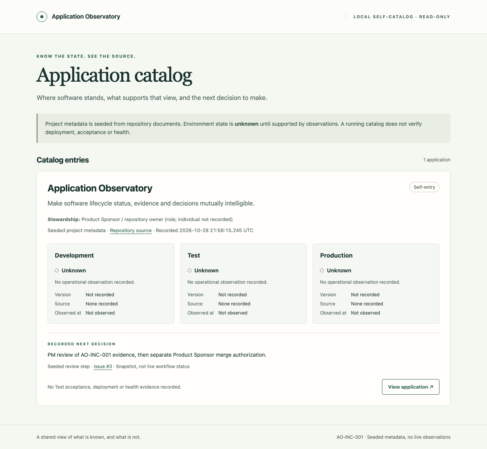

# AO-INC-001 — Developer evidence

Source: [`802ee4c3ab0bdd9babb00c688850a351427947f7`](https://github.com/bobrs/Application-Observatory/commit/802ee4c3ab0bdd9babb00c688850a351427947f7), a clean `feat/self-catalog` checkout based on `3e5ee4925540c300a9b1ae9bdc267254ea644a7a`. This evidence is added in a subsequent documentation/artifact commit; the PR reports checks at its final head separately.

## Commands and observed results

Environment: macOS / darwin arm64; Node.js **24.22.1**, npm **11.13.0**; Playwright **1.64.1**, Chromium **156.0.8078.4**. The pinned Node runtime and browser were installed into ignored project-local `.cache` directories; no global runtime or host configuration was changed.

With the pinned Node version selected:

```sh
npm ci --no-fund
npm run verify
PLAYWRIGHT_BROWSERS_PATH=.cache/playwright npx playwright install chromium
npm run demo
git diff --check
git status --porcelain=v1
```

- Lockfile installation passed; native `better-sqlite3` installed and ran on this platform. npm reported **0 known package vulnerabilities** during installation; this is not an independent security assessment.
- Type-check and compiled build passed.
- **8 Node tests passed; 0 failed/skipped.** These cover repeatable migration/seed; persisted metadata not overwritten; actual server-process restart and stopped-database restore; unsupported schema refusal; repository/sync-path and database-symlink rejection; list/detail provenance and explicit unknowns; read-only methods/local Host names; and HTML/link escaping using disposable fixtures.
- Browser demo passed at **1280 × 1000** and **390 × 844**: list-to-detail/back navigation, one self-entry, three unknown environment states, next decision, mobile layout without horizontal overflow, no page/console/HTTP errors and no external requests. Four full-page screenshots were visually inspected.
- Whitespace check passed; the source checkout was clean. [demo.json](demo.json) records the exact clean source revision and capture time. [SHA256SUMS](SHA256SUMS) identifies the captured artifacts.

All database fixtures were outside the source checkout and removed after use. Browser/server processes were closed. Capture timestamps are first-seed creation times, not operational observation times. No operator data was opened or created for these demonstrations.

## Screenshots

| Surface | Desktop | Mobile |
| --- | --- | --- |
| Catalog | [Catalog desktop](catalog-desktop.png) | [Catalog mobile](catalog-mobile.png) |
| Self-entry | [Detail desktop](detail-desktop.png) | [Detail mobile](detail-mobile.png) |



## Scope and limits

This is Dev's implementation evidence, not independent Test acceptance or a claim that any application is deployed or healthy. A fresh human operator has not independently accepted the instructions. Only macOS arm64 / Chromium was exercised; native binding compatibility, other operating systems and other browsers remain unverified. External evidence links were not independently verified. The data-path guard detects the checkout and common sync-folder names, not every possible synchronization setup. Local SQLite records are not tamper-proof.

The next decision is seeded as a review snapshot; it will not automatically track subsequent GitHub activity. There are no environment observations, status/candidate editing, correction history or gate controls in this increment. No CI, external deployment, credentials, GhostSentry3 access or later increment work was performed. PM review and separate Sponsor merge authorization remain required.
