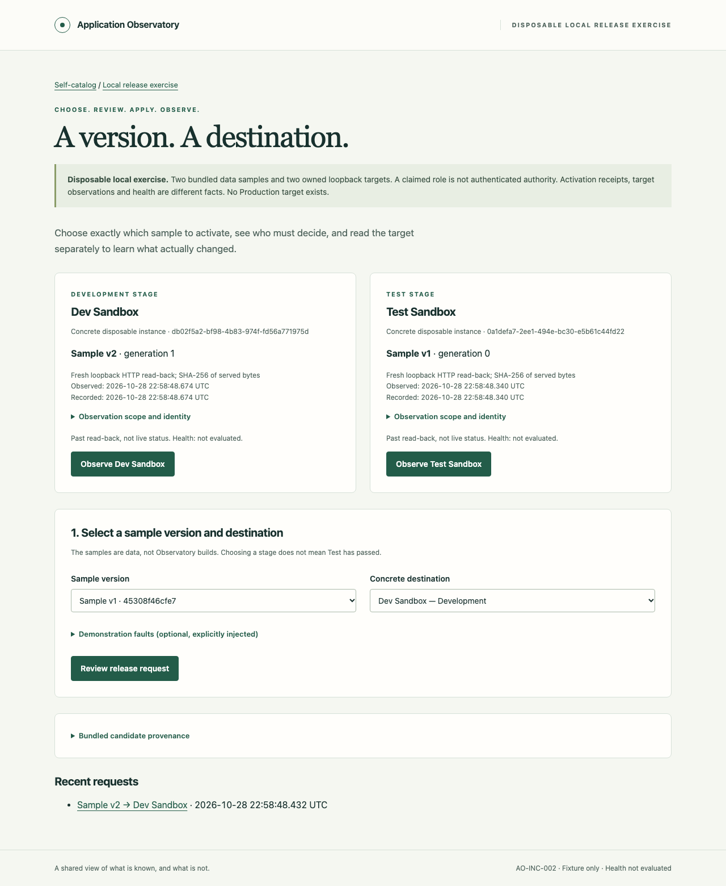

# AO-INC-002 — Developer evidence

Clean implementation source: [`45f9dbb5d5ca3a5d5f24bd84320acce118808b98`](https://github.com/bobrs/Application-Observatory/commit/45f9dbb5d5ca3a5d5f24bd84320acce118808b98), based on accepted main `f19a0ac2758a4d59709c06fbf5d75d9611b46545`. This report and captured artifacts are committed separately; the PR records its final-head validation. No application, test, dependency or configuration source changes are needed for the evidence commit.

## Commands and observed results

Pinned Node **24.22.1**, npm **11.13.0**, macOS arm64; Playwright **1.64.1**, Chromium **156.0.8078.4**. Existing project-local runtime/browser caches were used. The lockfile retains the same dependency set; no global tool, host configuration, CI or external deployment was introduced.

```sh
npm run verify
npm run demo:exercise
npm run demo
git diff --check
git status --porcelain=v1
```

- Type-check/build passed; **19 tests passed, zero failures/skips**. Tests include schema-1 migration without overwriting the self-entry, current schema repeatability, exact-scope decisions, missing/recommended/declined/expired decisions, duplicate requests, destination drift, target-side generation checks, known failure, lost receipt, unknown/conflicting read-back, same-origin/CSRF, escaped operator text and linked-file containment.
- An actual controller process was killed **after the fixture state changed and before receipt persistence**. Resume preserved an unknown result, prevented redispatch and invalidated pre-restart unused authorizations through the new boot identity. A fresh read established the bytes separately without rewriting the missing receipt.
- Symlinked target-state and hard-linked ledger fixtures were rejected without changing unrelated disposable sentinel files. This is tested containment, not a hostile same-user sandbox guarantee.
- The browser exercised the **same immutable sample in Development, then Test**, with distinct concrete instances. Request, bounded decision, explicit apply, receipt and separate read-back remain different facts. Desktop/mobile captures had no horizontal overflow, page/console/HTTP errors or external requests.
- Decline/refusal, injected failure, stale request, missing receipt after a real local change, and unreadable observation were exercised. A disabled button was also backed by a controller refusal. Fault modes are labeled demonstrations, not claims about external infrastructure.
- The default read-only self-catalog desktop/mobile regression passed, retaining one real self-entry and three honest unknown environments. [catalog-regression.json](catalog-regression.json) preserves the clean-source run details.
- The source checkout was clean. [demo.json](demo.json) records source SHA, dirty flag, capture time and scenario results. [SHA256SUMS](SHA256SUMS) identifies the nine screenshots and two reports. Final recorded test/demo runs close their owned processes and remove their disposable fixtures.

## Operator screenshots

| Scenario | Artifact |
| --- | --- |
| Development/Test destinations, v2 observed in Development first | [Destinations](destinations-desktop.png) |
| Completed receipt; observation still pending | [Receipt before read-back](receipt-before-observation.png) |
| Successful separate read-back | [Desktop](success-desktop.png), [Mobile](success-mobile.png) |
| Declined authorization and controller refusal | [Declined](declined.png) |
| Explicit injected pre-activation failure | [Failed](failed.png) |
| Expected generation drift blocks the stale request | [Stale](stale.png) |
| Real local activation with deliberately missing receipt | [Uncertain result](uncertain-result.png) |
| Fixture outage; observation remains unknown | [Unknown observation](unknown-observation.png) |



## Limits and remaining decisions

Dev evidence is not independent Test acceptance. Only macOS arm64/Chromium was exercised; other platforms/browsers and power-loss durability remain unverified. Same-host read-back witnesses fixture-served bytes, not organizational authority, real deployment or health. Self-declared roles are demonstrations. All candidates are bundled data; no candidate code runs. Stage is a classification, not a certification that Test passed or a general promotion policy.

SQLite and target changes are not a single transaction; missing execution receipts remain unknown even when later bytes match. Workspaces are disposable and may be removed by the OS; records are not tamper-proof. A malicious same-user process is outside this local containment boundary. The original self-entry's next-decision text remains a labeled historical snapshot. No generic adapter framework, forge intake, external integrations, real credentials, privileged operations or GhostSentry3 access was used.

PM review and separate Product Sponsor merge authorization are still required. No independent acceptance or approval of later increments is implied.
